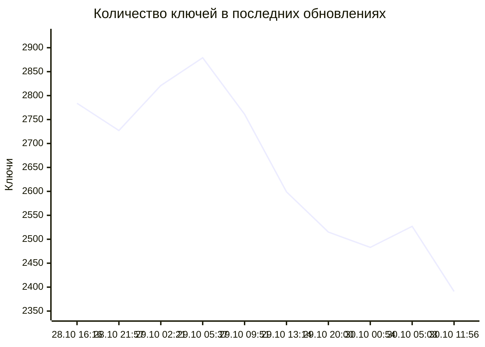

# WireVeil

WireVeil — автономный, автоматически обновляемый агрегатор публичных прокси-ключей для клиентов на базе Xray и sing-box. Он собирает все доступные конфигурации для обычного режима чёрных списков, строго проверяет URI, оставляет только один ключ на сочетание «протокол + сервер + порт» и исключает только подтверждённые российские endpoints.

Поддерживаются VLESS, Trojan, Shadowsocks, VMess, Hysteria, Hysteria2 (`hy2://` и `hysteria2://`) и TUIC. В каждой сборке обязательны шесть актуальных типов: VLESS, Trojan, Shadowsocks, VMess, Hysteria2 и TUIC. Парсер и отдельный файл Hysteria v1 сохраняются для совместимости, но этот устаревший тип сейчас отсутствует в выбранных живых источниках. WireGuard, AmneziaWG, многострочные конфигурации, JSON/YAML-клиенты и целиком Base64-кодированные выходные подписки не публикуются.

## Подписки

<!-- WIREVEIL_STATS_START -->
Последнее успешное обновление: **2026-10-30T11:56:17+03:00** (UTC: 2026-10-30T08:56:17Z).

| Подписка | RAW-ссылка | Ключей | Размер |
|---|---|---:|---:|
| Все протоколы | [RAW](https://raw.githubusercontent.com/markKikhtenko/WireVeil/main/subscription.txt) | 2391 | 473.0 KiB |
| VLESS | [RAW](https://raw.githubusercontent.com/markKikhtenko/WireVeil/main/vless.txt) | 691 | 146.5 KiB |
| Trojan | [RAW](https://raw.githubusercontent.com/markKikhtenko/WireVeil/main/trojan.txt) | 684 | 111.9 KiB |
| Shadowsocks | [RAW](https://raw.githubusercontent.com/markKikhtenko/WireVeil/main/shadowsocks.txt) | 230 | 20.1 KiB |
| VMess | [RAW](https://raw.githubusercontent.com/markKikhtenko/WireVeil/main/vmess.txt) | 302 | 101.5 KiB |
| Hysteria | [RAW](https://raw.githubusercontent.com/markKikhtenko/WireVeil/main/hysteria.txt) | 0 | 0 B |
| Hysteria2 | [RAW](https://raw.githubusercontent.com/markKikhtenko/WireVeil/main/hysteria2.txt) | 227 | 28.6 KiB |
| TUIC | [RAW](https://raw.githubusercontent.com/markKikhtenko/WireVeil/main/tuic.txt) | 257 | 64.3 KiB |

### Вклад источников в текущую сборку

`В итоговой подписке` — число ключей источника, оставшихся после валидации, приоритетной дедупликации и геофильтра.

| Источник | Статус | Распознано | Валидно | В итоговой подписке |
|---|---|---:|---:|---:|
| igareck Blacklist Mobile Top | ok | 142 | 130 | 18 |
| igareck Blacklist Mixed | ok | 110 | 109 | 13 |
| WLUnlocker Blacklist VPN 1 | ok | 109 | 91 | 2 |
| FLAT447 Blacklist LTE | ok | 136 | 136 | 96 |
| WLUnlocker Blacklist VPN 2 | ok | 200 | 200 | 99 |
| 0xRadikal Verified | ok | 1250 | 1240 | 721 |
| morpheusadam TUIC | ok | 260 | 260 | 257 |
| Argh94 All Config | ok | 2520 | 2468 | 1185 |

### История обновлений

Время указано по Москве. `Добавлено` и `удалено` считают изменения состава URI; для записей, созданных до появления этого учёта, доступно только чистое изменение `Δ`.

| Обновлено (МСК) | Всего | Добавлено | Удалено | Δ | Что изменилось |
|---|---:|---:|---:|---:|---|
| 28.10.2026 16:16 МСК | 2784 | +975 | −977 | -2 | VLESS +589/−608; Trojan +110/−212; SS +81/−61; VMess +118/−32; Hysteria2 +77/−64 |
| 28.10.2026 21:57 МСК | 2727 | +925 | −982 | -57 | VLESS +309/−552; Trojan +243/−153; SS +199/−90; VMess +56/−142; Hysteria2 +118/−45 |
| 29.10.2026 02:21 МСК | 2821 | +697 | −603 | +94 | VLESS +315/−263; Trojan +149/−89; SS +85/−80; VMess +50/−39; Hysteria2 +46/−49; TUIC +52/−83 |
| 29.10.2026 05:37 МСК | 2879 | +1095 | −1037 | +58 | VLESS +570/−345; Trojan +278/−344; SS +54/−166; VMess +151/−52; Hysteria2 +42/−130 |
| 29.10.2026 09:51 МСК | 2761 | +750 | −868 | -118 | VLESS +306/−510; Trojan +92/−105; SS +37/−47; VMess +261/−142; Hysteria2 +54/−64 |
| 29.10.2026 13:14 МСК | 2599 | +483 | −645 | -162 | VLESS +260/−349; Trojan +127/−178; SS +35/−48; VMess +48/−57; Hysteria2 +13/−13 |
| 29.10.2026 20:00 МСК | 2515 | +870 | −954 | -84 | VLESS +487/−357; Trojan +239/−237; SS +43/−57; VMess +73/−275; Hysteria2 +28/−28 |
| 30.10.2026 00:54 МСК | 2483 | +689 | −721 | -32 | VLESS +388/−476; Trojan +125/−106; SS +64/−34; VMess +67/−60; Hysteria2 +41/−41; TUIC +4/−4 |
| 30.10.2026 05:03 МСК | 2527 | +730 | −686 | +44 | VLESS +425/−360; Trojan +134/−181; SS +62/−45; VMess +81/−61; Hysteria2 +28/−39 |
| 30.10.2026 11:56 МСК | 2391 | +679 | −815 | -136 | VLESS +295/−451; Trojan +112/−165; SS +51/−78; VMess +201/−98; Hysteria2 +20/−23 |


<!-- WIREVEIL_STATS_END -->

`stats.json` содержит подробную статистику, размеры и SHA-256 текущей сборки. В `update-history.json` хранятся последние 20 успешных обновлений.

### Проверенные подключения

<!-- WIREVEIL_HEALTH_START -->
Последняя проверка реального подключения: **2026-10-30T11:59:19+03:00** (UTC: 2026-10-30T08:59:19Z). Проверено через `sing-box version 1.14.0`: **778 из 2391** конфигураций передали HTTPS-трафик; после endpoint-дедупликации опубликовано **778**.

| Подписка | RAW-ссылка | Ключей | Размер |
|---|---|---:|---:|
| Только активные и проверенные | [RAW](https://raw.githubusercontent.com/markKikhtenko/WireVeil/main/active.txt) | 778 | 135.3 KiB |
| Рабочие и быстрые (≤ 500 мс) | [RAW](https://raw.githubusercontent.com/markKikhtenko/WireVeil/main/good.txt) | 542 | 92.6 KiB |
<!-- WIREVEIL_HEALTH_END -->

Подписки образуют три уровня:

- `subscription.txt` — все кандидаты из доступных источников после геофильтра и endpoint-дедупликации.
- `active.txt` — все реально рабочие ключи по результатам текущего HTTPS-теста через `sing-box`. Повторные сочетания «протокол + сервер + порт» схлопываются с сохранением самого быстрого рабочего варианта. Медленные, но рабочие серверы остаются здесь.
- `good.txt` — рабочие и быстрые: подмножество уже сформированного `active.txt` с измеренной задержкой **не выше 500 мс** по умолчанию и без зафиксированных ошибок. Порог настраивается; URI и их относительный порядок сохраняются.

`good.txt` использует задержку HTTPS-проверки, которую уже возвращает локальный Clash API sing-box. Таймауты, ошибки, отсутствие корректной задержки и превышение порога исключают ключ только из `good.txt`. Если первый HTTPS endpoint завершился ошибкой, а запасной сработал, ключ остаётся в `active.txt`, но не проходит фильтр `good.txt`. Дополнительные запросы и ping не выполняются; текущая логика sing-box healthcheck и отбора `active.txt` сохраняется.

Это оценка по текущему прогону, а не проверка долговременной стабильности. Доступность и задержка зависят от сети, где запущен health-check: автоматическая публикация проверяется с GitHub-hosted runner, а локальный запуск — с текущей машины. Ни один из этих результатов не гарантирует такую же доступность у конкретного российского провайдера.

## Источники

| Источник | Назначение | Приоритет |
|---|---|---:|
| [igareck Blacklist Mobile Top](https://raw.githubusercontent.com/igareck/vpn-configs-for-russia/refs/heads/main/BLACK_VLESS_RUS_mobile.txt) | Компактная подборка лучших проверенных конфигураций | 100 |
| [igareck Blacklist Mixed](https://raw.githubusercontent.com/igareck/vpn-configs-for-russia/refs/heads/main/BLACK_SS%2BAll_RUS.txt) | Проверенные альтернативные протоколы | 95 |
| [WLUnlocker Blacklist VPN 1](https://raw.githubusercontent.com/wlunlocker/vpn-configs/main/blacklist_vpn1.txt) | Компактная VLESS-подписка | 90 |
| [FLAT447 Blacklist LTE](https://raw.githubusercontent.com/FLAT447/v2ray-lists/refs/heads/main/BLACK_LTE.txt) | Компактная подборка для российского режима чёрных списков | 85 |
| [WLUnlocker Blacklist VPN 2](https://raw.githubusercontent.com/wlunlocker/vpn-configs/main/blacklist_vpn2.txt) | Компактная Shadowsocks/Hysteria2-подписка | 80 |
| [0xRadikal Verified](https://raw.githubusercontent.com/0xRadikal/Free-v2ray-Configs/main/verified/configs.txt) | Конфигурации после трёх раундов реальных proxy-запросов | 70 |
| [morpheusadam TUIC](https://raw.githubusercontent.com/morpheusadam/v2ray-config/main/subs/bundles/tuic.txt) | Ежедневно проверяемый резерв TUIC | 55 |
| [Argh94 All Config](https://raw.githubusercontent.com/Argh94/Proxy-List/main/All_Config.txt) | Широкий резерв актуальных URI-протоколов | 50 |

Полная машиночитаемая конфигурация находится в [`sources.json`](./sources.json). Источник с более высоким приоритетом побеждает при обнаружении семантически одинаковых ключей.

## Использование

Добавьте RAW-ссылку `good.txt` для рабочих и быстрых серверов, `active.txt` для всех проверенных рабочих или `subscription.txt` для полного пула кандидатов, если клиент поддерживает URL-подписки с обычным списком URI. Если установленная версия клиента умеет импортировать только отдельные ключи, откройте нужный RAW-файл из таблицы, скопируйте строки и добавьте их вручную. Каждый файл — обычный UTF-8 TXT: один исходный URI на строку, без Base64-обёртки.

Проект рассчитан прежде всего на обычное проводное подключение и конфигурации для обхода чёрных списков. Он намеренно не создаёт и не изменяет подписки для модемных роутеров.

## Портативная проверка из своей сети

[**⬇ Скачать WireVeilChecker для Windows x64 (portable ZIP)**](https://github.com/markKikhtenko/WireVeil/releases/latest/download/WireVeilChecker-windows-x64.zip)

`WireVeilChecker` — графическое Windows-приложение без установки с двумя независимыми вкладками. «NekoBox / sing-box» сохраняет прежний сценарий share-URI. «Mihomo / OpenClash» принимает множество URL, YAML-файлов, TXT-списки и CSV-каталоги с явной колонкой `subscription_url`; каждая строка становится отдельным источником с собственным `source_id` и provenance. Для GitHub RAW по умолчанию показывается понятная метка `owner/repo — filename`, а не одинаковый hostname. Вкладка запускает отдельный локальный `mihomo.exe`, проверяет реальную передачу HTTPS-трафика и формирует обезличенный ZIP (`report.json`, `summary.md`, `nodes.csv`) либо отдельный приватный YAML рабочих узлов. Обычный ICMP-ping намеренно не используется: сервер может блокировать его, а доступный порт ещё не означает, что прокси передаёт трафик.

Для многотысячных Mihomo-подписок быстрые лимиты 50/100/500 теперь используют воспроизводимую стратифицированную выборку по всем источникам и протоколам, а не первые строки одного фида. Также есть этапы «20 на источник», «100 на источник» и явно подтверждаемый полный режим; seed выборки сохраняется в отчёте. Базовые HTTPS-тесты запускаются с 16 потоками по умолчанию (можно выбрать 8/16/24) и при шквале тайм-аутов или controller API 503 автоматически снижаются до 8; сервисные тесты всегда ограничены восемью потоками. Отдельная вкладка журнала показывает количество, время, скорость и ETA загрузки, парсинга, дедупликации, пакетной валидации, запуска ядра, HTTPS и сервисных проверок. Невалидные конфигурации локализуются рекурсивным делением пакета с ограничением числа дочерних процессов; остановка работает во время подготовки и оставляет доступным экспорт частичных результатов. UUID, пароли, токены URL и приватные ключи в журнал не выводятся.

Mihomo-интерфейс имеет компактный режим «Обзор» (источник, имя, протокол, статус, HTTPS 0/2–2/2, ChatGPT/Instagram/Spotify и причина), подробный режим, фильтры и безопасное окно деталей по двойному клику. Шрифт Segoe UI 11 pt можно увеличить кнопками `−/+`; размер, режим таблицы, sampling и параллельность сохраняются отдельно. Компоновка автоматически перестраивает панели при узком окне и проверяется тестами при Windows scaling 125% и 150%.

Приложение и его окно используют собственную многоразмерную иконку WireVeil вместо стандартного значка Python/Tk.

Стартовый экран сделан для одного действия: вставить подписку и нажать красную кнопку «Сделать заебись». Ручные прогоны, тайм-аут, число потоков, порог ping и выбор сайтов спрятаны под кнопкой «Открыть настройки». Два фоновых режима вынесены в отдельные карточки с живым обратным отсчётом до следующего запуска; для короткого контроля доступности есть отдельная кнопка «Проверить сейчас». По умолчанию каждый узел должен успешно пройти два независимых прогона. Весь список показывается сразу, а задержка обновляется в строке по мере ответа каждого сервера. Любая колонка сортируется кликом по заголовку в обе стороны, включая меньший/больший ping. Можно выделить несколько строк через Ctrl/Shift и скопировать их кнопкой или Ctrl+C. После проверки можно сохранить все доступные серверы, только быстрые либо скопировать годные share-ссылки прямо в буфер обмена для NekoBox.

Настройки sing-box и содержимое его поля подписки сохраняются в `WireVeilChecker.config.json`. Список Mihomo-источников хранится отдельно в `WireVeilChecker.mihomo-sources.json`, а UI-настройки — в `WireVeilChecker.mihomo-ui.json`; свежие результаты между запусками не подменяются старыми. Эти файлы остаются только на компьютере и исключены из Git. Список источников может содержать приватные URL, ключи или вставленный YAML, поэтому его нельзя публиковать или передавать посторонним.

Кнопка «Очистить» рядом с полем подписки удаляет и видимый текст, и сохранённое значение. Для редактирования поля явно поддерживаются Ctrl+C, Ctrl+V, Ctrl+X и Ctrl+A при английской и русской раскладке, а также Ctrl+Insert и Shift+Insert.

Отдельная проверка сайтов запускается для зелёных серверов. В выпадающем меню с галочками можно одновременно выбрать ChatGPT, YouTube, GitHub, Google, Discord и Telegram Web. Для каждого выбранного сервиса появляется собственная сортируемая колонка с доступностью и задержкой, поэтому общий зелёный HTTPS-тест не маскирует блокировку конкретного домена. При изменении выбора старые результаты очищаются; cookies и данные учётных записей не используются. Поэтому ответ ChatGPT `HTTP 401/403` помечается как «домен отвечает» и считается успешной сетевой доступностью: он подтверждает, что запрос дошёл до сервиса, хотя не подтверждает вход в аккаунт или полноценную работу браузерной сессии.

После сервисного теста умная итоговая сортировка ставит наверх серверы, открывшие все выбранные сайты: только они остаются зелёными и попадают в экспорт «годных». Частичный доступ отмечается жёлтым, отсутствие доступа — красным, поэтому низкий общий ping больше не скрывает неработающий целевой сервис. Красная кнопка «Сделать заебись» запускает полный сценарий без ручной настройки: ping, скорость зелёных, все сайты, итоговая сортировка и копирование полностью прошедших ключей в буфер. Авторежим повторяет именно этот полный сценарий через выбранное число минут и заново загружает URL подписки.

Отдельный флажок «Контроль доступности» предназначен для лёгкой фоновой проверки. При копировании годных приложение запоминает этот набор, а затем с выбранным интервалом (по умолчанию 30 минут) выполняет для него только один реальный HTTPS-прогон. Карточка показывает обратный отсчёт и число серверов на контроле. Подписка заново не загружается, скорость и сайты не тестируются. Таблица показывает, сколько из ранее скопированных серверов доступны прямо сейчас; исходный набор сохраняется, поэтому временно недоступный сервер будет проверен снова в следующий раз.

Пинг и скорость отображаются раздельно. Тест скорости выполняет дополнительную загрузку 1 МБ через каждый итоговый зелёный сервер и показывает пропускную способность в Мбит/с; красные, жёлтые и не прошедшие все прогоны узлы этот трафиковый тест не запускают. Его можно вызвать отдельно из дополнительных настроек либо как часть явно запущенного полного цикла и авторежима.

Готовый `WireVeilChecker-windows-x64.zip` публикуется в [GitHub Releases](https://github.com/markKikhtenko/WireVeil/releases) для тегов `checker-v*`. Достаточно распаковать архив и запустить `WireVeilChecker.exe`; Python, NekoBox и права администратора для самой проверки не нужны. Исходный код интерфейса находится в [`checker_app.py`](./checker_app.py), подробная инструкция — в [`PORTABLE-CHECKER.md`](./PORTABLE-CHECKER.md).

Релизы сейчас публикуются без Authenticode-подписи, пока сертификат не добавлен в GitHub Secrets, поэтому Windows Defender/SmartScreen может показать предупреждение. После настройки по инструкции [`SIGNING.md`](./SIGNING.md) workflow автоматически подпишет приложение, вложенный `sing-box` и библиотеку перед упаковкой ZIP.

Поддерживаются VLESS, Trojan, Shadowsocks, VMess, Hysteria2 и TUIC в виде share-ссылок, в том числе Base64-подписки. Клиентские JSON/YAML-конфигурации без share-ссылок, WireGuard и AmneziaWG пока не поддерживаются.

## Локальная сборка

Нужен Python 3. Внешних зависимостей нет.

```bash
python -m unittest discover -s tests -v
python scripts/build.py
python scripts/healthcheck.py --sing-box /path/to/sing-box
```

Сборщик повторяет временно неудачные запросы, требует доступности всех основных источников, однократно распознаёт Base64-обёрнутый вход и сначала проверяет полный результат во временной директории. Сначала удаляются полностью эквивалентные конфигурации, затем для каждого сочетания «протокол + сервер + порт» остаётся ключ из источника с наивысшим приоритетом. После этого применяется геофильтр и публикуется весь оставшийся пул. Публикация отменяется, если ключей меньше защитного минимума, отсутствует любой из шести обязательных актуальных протоколов или результат не проходит проверку. При необходимости параметры `--target-keys` и `--max-keys` позволяют вручную вернуть точную выборку и верхний предел.

После сборки health-check запускает закреплённый официальный `sing-box`, конвертирует поддерживаемые URI в отдельные outbounds и проверяет каждый через один из двух HTTPS `generate_204` endpoints посредством локального Clash API. ICMP-пинг не используется. Неподдерживаемые, не подключившиеся и не передавшие HTTPS-трафик ключи не попадают в `active.txt`; при системной ошибке или слишком малом результате последняя рабочая активная подписка не перезаписывается. Подробности последнего прогона находятся в `active-stats.json`.

Фильтр качества настраивается в [`healthcheck-config.json`](./healthcheck-config.json), который команда healthcheck читает автоматически:

```json
{
  "good": {
    "enabled": true,
    "max_latency_ms": 500
  }
}
```

`max_latency_ms` — положительное целое число в миллисекундах; равенство порогу допускается. Для другой конфигурации используйте `python scripts/healthcheck.py --sing-box /path/to/sing-box --config /path/to/config.json`. JSON читается стандартной библиотекой Python, дополнительные зависимости не нужны. Изменение файла конфигурации запускает существующий workflow обновления.

При `enabled: false` успешный прогон публикует пустой `good.txt` и `total_good: 0`, чтобы не оставлять устаревшую подборку. Пустой результат фильтра также допустим при включённом фильтре: он не отменяет публикацию `active.txt`. Прежний защитный минимум `--min-active` применяется только к активным ключам. Все выходные файлы сначала проверяются во временной директории; при ошибке проверки или недостижении минимума предыдущие подписки и статистика сохраняются.

В `active-stats.json` сохраняются прежние поля и дополнительные данные:

- `total_active` и `total_good` — число опубликованных ключей после endpoint-дедупликации.
- `latency_min`, `latency_avg`, `latency_max` — минимум, среднее и максимум измеренных задержек в `active.txt`, в миллисекундах. Эти же поля внутри `good` описывают только `good.txt`; при отсутствии измерений значения равны `null`.
- `active_by_protocol` и `good_by_protocol` — распределение по протоколам для каждой подписки, включая нулевые значения.
- `good.enabled` и `good.max_latency_ms` — настройки, применённые в этом прогоне.
- `probe_results` — сохранённые результаты каждой проверки: `candidate_index` (индекс строки кандидата с нуля), `uri_sha256` (SHA-256 исходного URI в UTF-8 без перевода строки), `active`, `latency_ms` и `error`. Неуспешная проверка имеет `latency_ms: null`; успех через запасной URL после ошибки первого запроса сохраняет и задержку, и предыдущую ошибку. Поле `candidate_subscription_sha256` связывает результаты с проверенным пулом.
- `output_file` и `good_output_file` — число ключей, размер и SHA-256 файлов `active.txt` и `good.txt` соответственно.

При добавлении фильтра начальный `good.txt` оставлен пустым до первого успешного healthcheck с новой логикой публикации. Старые отчёты `active-stats.json` содержат только агрегаты задержек: восстановить по ним качество отдельных серверов нельзя. Следующий успешный прогон автоматически заполняет подписку и добавляет новые поля статистики.

Геофильтр определяет страну только по фактическому адресу `server`: доменное имя разрешается в IP, затем точное назначение адреса проверяется через authoritative RDAP. Это важно для небольших российских сетей, переприсвоенных внутри крупного иностранного блока и потому отсутствующих в верхнеуровневой статистике делегаций. Ответы RDAP кешируются по возвращённому диапазону в `geo-cache.json` на семь дней. SNI, Host, флаг и подпись ключа не используются как доказательство страны. Подтверждённые RU-endpoints исключаются, а `UNKNOWN` сохраняются.

## Важное предупреждение

Это публичные бесплатные серверы третьих лиц. WireVeil не владеет ими, не управляет ими и не гарантирует их доступность, конфиденциальность или безопасность. Оператор сервера потенциально может наблюдать незашифрованный трафик и метаданные. Не передавайте через непроверенные серверы чувствительные данные, используйте сквозное шифрование и считайте любой ключ недоверенным.

Используйте WireVeil только в законных целях и с соблюдением применимого законодательства и правил используемых сервисов.

Код проекта распространяется по лицензии [MIT](./LICENSE).
